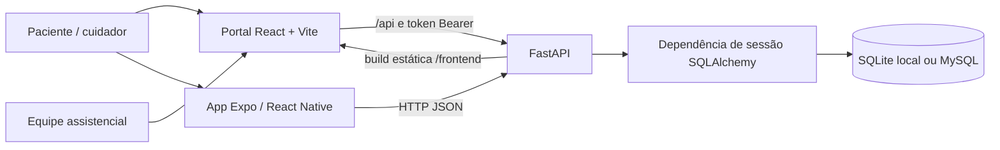
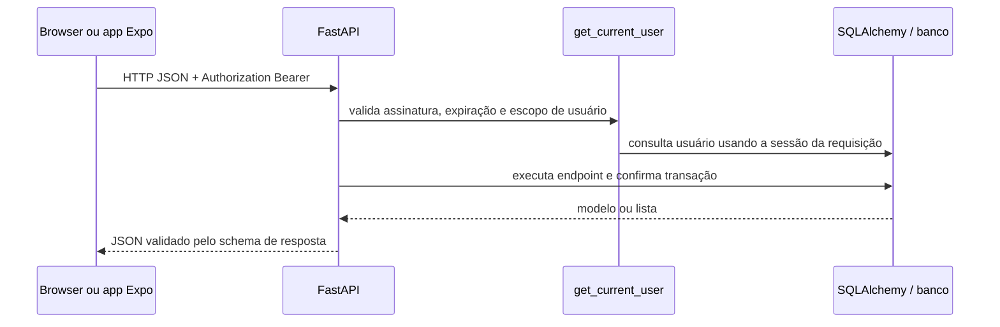

# Arquitetura do Zelo

**Objetivo:** explicar como os clientes ativos compartilham a API e como uma requisição chega ao banco.

## Visão geral

Durante desenvolvimento, o Vite serve a SPA e encaminha `/api` e `/health` à API. Em uma build, `backend/app/main.py` monta os arquivos de `frontend/dist` sob `/frontend/` e a raiz redireciona para a SPA compilada. O app Expo chama a mesma API com uma URL configurada pelo ambiente ou pela plataforma.

## Fluxo de uma requisição autenticada

Login e cadastro público não exigem token. Rotas não relacionadas a `/api/` também não passam pela regra de sessão. Os detalhes de papel e limites estão em [Backend](BACKEND.md).

## Componentes e pastas

| Caminho | Responsabilidade |
|---|---|
| `backend/app/main.py` | Cria a aplicação, configura CORS, dependência global de autenticação, routers, arquivos estáticos e startup. |
| `backend/app/routers/` | Endpoints de cadastro/login, usuários, dados clínicos, medicações e orientações. |
| `backend/app/models.py` | Entidades ORM e relações entre usuário e registros. |
| `backend/app/schemas.py` | Validação dos payloads e formato JSON de entrada/saída. |
| `backend/app/security.py` | Hash de senha, token HMAC e regra de acesso por usuário/papel. |
| `backend/app/database.py` | Engine, `Base`, fábrica de sessão e dependência `get_db`. |
| `frontend/src/App.tsx` | Estado da sessão, seleção do portal, navegação e carregamento de dados. |
| `frontend/src/api.ts` | Cliente HTTP tipado, token Bearer e mapeamento de erros. |
| `frontend/src/features/` | Jornadas de paciente, equipe, login, chatbot e acessibilidade. |
| `frontend/src/components/` | Componentes de interface reutilizáveis. |
| `frontend/src/context/AccessibilityContext.tsx` | Preferências visuais, fonte, movimento e atalhos de teclado. |
| `mobile-app/App.tsx` | Navegação por estado e coordenação de sessão/dados do Expo. |
| `mobile-app/api.ts` | Chamadas HTTP e adaptação de tipos para React Native. |
| `iniciar_zelo.sh`, `iniciar_zelo.bat` | Inicialização dos três processos em ambiente de desenvolvimento. |

## Decisões observadas no código

- O backend é a fonte de persistência comum aos dois clientes; o portal também conserva preferências de visual e a sessão local no navegador.
- A SPA não usa uma biblioteca de roteamento: `App.tsx` seleciona páginas por estados tipados.
- O backend escolhe SQLite por padrão e aceita outra URL SQLAlchemy em `DATABASE_URL`; `docker-compose.yml` oferece MySQL e phpMyAdmin para desenvolvimento.
- A autorização é aplicada por uma dependência FastAPI global e complementada por verificações do papel e do `user_id` em `security.py`.
- O startup usa `Base.metadata.create_all`, uma alteração pontual de coluna e a rotina `seed_initial_data`; não há ferramenta de migração versionada no inventário atual.

## Pastas que não participam da SPA compilada

`frontend/pages/`, `frontend/paciente/`, `frontend/assistencial/`, `frontend/styles/`, `frontend/scripts/` e `frontend/login.html` contêm interfaces/scripts HTML anteriores. A build Vite padrão tem `frontend/index.html` como entrada e importa a aplicação de `frontend/src/main.tsx`. Mantenha essas pastas até haver decisão explícita de migração ou arquivamento; não são apagadas nesta documentação.
